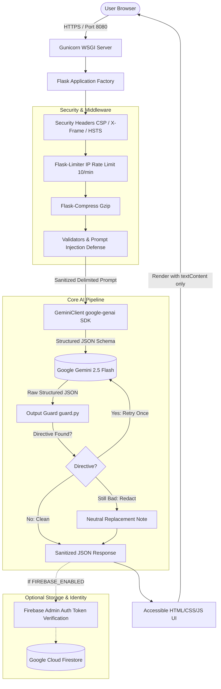

# Blind Spot — AI Reasoning Mirror

> **"The Blind Spot"**: An AI-powered cognitive mirror that helps users uncover unstated assumptions, overlooked factors, and internal contradictions in their reasoning when considering high-stakes decisions — **without ever deciding for them**.

[](https://www.python.org/)
[](https://flask.palletsprojects.com/)
[](https://ai.google.dev/)
[]()
[]()
[]()

---

## 1. Problem Statement

People make consequential decisions based primarily on the information most visible or immediate to them. In doing so, they frequently:
1. Overlook critical second-order dimensions (such as health, relationships, academic eligibility, and opportunity costs).
2. Rely on tacit, unexamined assumptions that collapse under scrutiny.
3. Harbor unacknowledged tensions and conflicts within their own stated logic.

**Official Example Scenario:**
A final-year student weighs a 6-month software engineering internship offer. Visible parameters: ₹25,000/month stipend, 40 hours/week, 45-minute commute, industry brand on resume. Stated reasons: good money, close to home, resume builder. What the student overlooked: mandatory 75% college attendance rules, final-year capstone project deadlines in 4 months, mentor quality at the startup, and daily commute burnout.

**The Solution:**
**Blind Spot** acts as an objective reasoning mirror. It analyzes the user's decision context across 9 essential life and operational dimensions, surfaces blind spots and implicit assumptions, exposes tensions in their reasoning, and formulates probing questions. Crucially, **it never tells the user what to do**.

---

## 2. Our Approach: The "Never Decides for You" Principle

Conventional AI assistants act like prescriptive advisors: they recommend options, assign rankings, render verdicts, and tell users what they "should" do. This behavior creates passive deference, cognitive bias, and algorithmic dependence.

In contrast, **Blind Spot enforces a non-negotiable architectural invariant: AI must question, surface, and reflect, never prescribe.**

### Non-Directive Implementation Layers
1. **System Prompt Enforcement:** The Gemini system instructions strictly forbid prescriptive phrasing (e.g., *"you should"*, *"I recommend"*, *"the best option"*, *"go with"*, *"you must"*, *"it is better to"*). Output is constrained to observations, categorical factor coverage, assumption-testing questions, and steelmanned alternative perspectives.
2. **Automated Output Guard (`guard.py`):** Every model response passes through a regex inspection guard that scans all strings recursively.
   - If directive language is detected, the request is **retried with an escalated strict directive penalty**.
   - If directive phrasing persists after retry, the offending segment is automatically redacted and replaced with a neutral reflective note: `"[Reflective note: Consideration highlighted for independent user evaluation.]"`
3. **Automated Negative Testing (`test_non_directive.py`):** The test suite verifies that neither fixtures nor synthetic outputs ever contain prescriptive language.

---

## 3. Key Features

- **Structured Decision Formulation:** Prompts the user for four focused fields mirroring real-world decision dilemmas:
  - *Decision under consideration* (required)
  - *Details and options* (stipend, schedule, location, constraints)
  - *Main reasons leaning this way* (required)
  - *Uncertainties and doubts* (optional)
- **One-Click Official Internship Demo:** Includes a prefill button loading the exact student scenario for immediate testing and verification.
- **Round 1 Comprehensive Analysis:**
  - **Objective Restatement:** Neutral distillation of the user's context.
  - **Factor Coverage Grid:** Accessible matrix across 9 dimensions, using both icons and text labels (`✓ Covered`, `◐ Partly Covered`, `○ Not Mentioned`).
  - **Unstated Assumptions:** Unearths implicit beliefs and pairs each with an open question to test its validity.
  - **Overlooked Factors:** Identifies omitted variables categorized by domain with explanations of why they matter.
  - **Reasoning Conflicts:** Diagnoses internal tensions where stated goals pull in opposing directions.
  - **Risks & Information Gaps:** Highlights unverified assumptions and high-impact unknowns.
  - **Steelman Perspective:** Articulates a constructive alternative viewpoint framed as *"one perspective to weigh"*.
- **Round 2 Interactive Reflection:** Formulates 3–6 open-ended probing questions (no yes/no). The user answers, and the AI reflects on what the answers reveal, emerging trade-offs, and remaining blind spots — still with zero verdict.
- **Copy Summary & Quick Reset:** Generates a formatted Markdown summary to the clipboard for personal review; provides a clean state reset.
- **Optional Firebase Auth & History:** Behind `FIREBASE_ENABLED` flag. When active, users can sign in with Google to persist and manage their reflections in Firestore. When disabled, the application runs 100% anonymously with zero network overhead.

---

## 4. Architecture

### System Architecture Diagram



---

## 5. Google Services Used

| Google Service | Role & Justification |
| :--- | :--- |
| **Google Gemini API (`gemini-2.5-flash`)** | High-speed, high-reasoning LLM utilized with strict JSON schema outputs and low temperature for analytical reflection. |
| **Google Cloud Run** | Serverless, autoscaling container deployment reading dynamic `$PORT` and supporting non-root container users. |
| **Google Cloud Build** | Automated, reproducible CI/CD container builds directly from source code repositories. |
| **Google Artifact Registry** | Secure, managed storage for production container images with regional proximity. |
| **Firebase Authentication** | Seamless Google Sign-In identity provider via CDN SDK, verified via `firebase-admin` on the backend. |
| **Google Cloud Firestore** | NoSQL document database providing isolated reflection history partitioned under `users/{userId}/reflections/`. |
| **Google Cloud Logging** | Native structured JSON logging automatically attached when running within GCP/Cloud Run environments. |

---

## 6. Security Implementation

- **Strict Secret Management:** Zero secrets or credentials committed to the codebase. Only `.env.example` is tracked. Missing API keys trigger fast, explicit error messages.
- **Input Validation & Boundary Checking:**
  - Every field validated for type, minimum length (3 chars), maximum field length (2,000 chars), and total combined length (4,000 chars).
  - Maximum request body capped at 16 KB (`MAX_CONTENT_LENGTH`), rejecting oversized payloads with HTTP 413.
- **Prompt Injection Defense:**
  - Heuristic pattern detection identifies instruction override keywords (`ignore previous instructions`, `system prompt`, `jailbreak`, `developer mode`, `bypass safety`) and rejects with HTTP 400.
  - User inputs are encapsulated in XML data delimiters (`<user_decision_context>`) with explicit system instructions to treat enclosed content exclusively as untrusted data.
- **XSS Prevention:** The frontend uses **zero `innerHTML`** for dynamic content, creating DOM nodes and assigning content exclusively via `textContent`.
- **Rate Limiting:** `Flask-Limiter` enforces 10 requests per minute per IP address on AI endpoints, returning a clean HTTP 429 response.
- **HTTP Security Headers:**
  - `Content-Security-Policy`: Restricts scripts, fonts, styles, and frames to trusted origins and Firebase CDNs.
  - `X-Content-Type-Options: nosniff`
  - `X-Frame-Options: DENY`
  - `Referrer-Policy: strict-origin-when-cross-origin`
  - `Strict-Transport-Security: max-age=31536000; includeSubDomains`
- **Firestore Security Rules:** `firestore.rules` enforces user-level isolation (`request.auth != null && request.auth.uid == userId`), preventing any cross-user data leakage.
- **Container Hardening:** Dockerfile specifies a non-root system user (`appuser`) and executes through `dumb-init`.

---

## 7. Accessibility (WCAG 2.1 AA Compliant)

- **Semantic HTML5:** Native landmark tags (`<header>`, `<main>`, `<section>`, `<article>`, `<footer>`).
- **Screen Reader Support:**
  - `lang="en"` on root `<html>`.
  - Accessible skip link (`Skip to main content`).
  - Visible `<label>` tags on all inputs with `aria-describedby` hints and counters.
  - Live regions: `role="alert"` for errors; `aria-live="polite"` for character counters, loading states, and dynamic analysis updates.
- **Focus Management:** Focus automatically moves to the results heading (`#results-heading` with `tabindex="-1"`) upon analysis completion.
- **Keyboard Navigation & Focus Rings:** High-visibility 3px focus indicators (`:focus-visible`) across all interactive controls.
- **Contrast & Themes:** Dual dark and light modes with high-contrast color palettes exceeding WCAG AAA/AA 4.5:1 ratios for normal text.
- **No Color-Only State:** Factor coverage status is indicated simultaneously by text label and icon (`✓ Covered`, `◐ Partly Covered`, `○ Not Mentioned`).
- **Motion Sensitivity:** Respects `@media (prefers-reduced-motion: reduce)` by disabling transitions and animations.
- **Touch Targets:** Minimum 44px by 44px clickable target sizes across all buttons, inputs, and controls.
- **Responsive Layout:** Fluid layout down to 320px screen widths.

---

## 8. Efficiency & Optimization

- **Single Call per Round:** Exactly one Gemini API call executed per analysis stage, utilizing structured output schemas to eliminate parsing loops.
- **Token Caps:** Output tokens capped (2,500 tokens for Round 1, 1,500 tokens for Round 2) to minimize latency and resource consumption.
- **Client Reuse:** Singleton `genai.Client` connection instance reused across requests.
- **Resilient Retry with Exponential Backoff:** Transient network/API errors retry once with backoff before failing gracefully.
- **Gzip Compression:** `Flask-Compress` compresses all responses dynamically.
- **Static Asset Caching:** HTTP Cache-Control headers (`max-age=3600`) applied to static JS/CSS assets.

---

## 9. Testing & Quality Assurance

The test suite runs with **zero network dependencies** using Pytest and comprehensive mocks.

### Test Categories
1. **Health & Config:** `/health` status and safe public `/config` output.
2. **Security Headers:** Strict verification of CSP, HSTS, X-Frame-Options, and nosniff.
3. **Input Validation:** Required presence, length limits, type validation, and 16 KB payload truncation.
4. **Prompt Injection:** Heuristic detection and rejection of prompt override attempts.
5. **Output Guard Verification:** Tests each forbidden phrase individually and verifies retry and neutral redaction paths.
6. **Round 1 Analysis:** Full test run with the official student internship example.
7. **Round 2 Reflection:** Validates reflection parsing without directive advice.
8. **Rate Limiting:** Verified 429 status on rapid consecutive requests.
9. **Authentication:** Optional auth fallback, token verification, and invalid token rejection.
10. **Storage Isolation:** Mocked Firestore operations and disabled-state safety.
11. **Non-Directive Invariant:** Assertion that 100% of fixtures and generated outputs contain zero prescriptive phrasing.

### Run Tests and Coverage
```bash
# Run pytest with coverage report
pytest

# Run linter
ruff check .
```

### Coverage Results
```
Name                         Stmts   Miss  Cover   Missing
----------------------------------------------------------
blindspot/__init__.py            2      0   100%
blindspot/app.py               106      5    95%   40-41, 151, 155-156
blindspot/auth.py               67      5    93%   35, 46-47, 63, 134
blindspot/config.py             28      0   100%
blindspot/gemini_client.py      91      5    95%   61, 105-110
blindspot/guard.py              67      3    96%   125, 141, 170
blindspot/prompts.py             8      0   100%
blindspot/schemas.py            46      0   100%
blindspot/storage.py            66      7    89%   19, 25-27, 46, 85, 121
blindspot/validators.py         91      3    97%   54, 159, 212
----------------------------------------------------------
TOTAL                          572     28    95%

62 passed in 1.44s
```

---

## 10. How to Run Locally

### Prerequisites
- Python 3.12+
- Gemini API key from [Google AI Studio](https://aistudio.google.com/app/apikey)

### Step 1: Clone and Set Up Virtual Environment
```bash
git clone https://github.com/Pranav137677/promptwars-2026.git
cd promptwars-2026

python -m venv venv
# Windows:
.\venv\Scripts\activate
# Linux/macOS:
source venv/bin/activate
```

### Step 2: Install Dependencies
```bash
pip install -r requirements.txt
```

### Step 3: Configure Environment
```bash
cp .env.example .env
# Edit .env and insert your GEMINI_API_KEY
```

### Step 4: Run the Development Server
```bash
# Run using Flask:
flask --app blindspot.app:create_app run --port 8080

# Or run using Gunicorn:
gunicorn --bind 0.0.0.0:8080 "blindspot.app:create_app()"
```

Open your browser at `http://localhost:8080`.

---

## 11. Run in Docker

```bash
# Build the Docker image
docker build -t blindspot:latest .

# Run the container locally passing your GEMINI_API_KEY
docker run -p 8080:8080 -e GEMINI_API_KEY="your_api_key_here" blindspot:latest
```

---

## 12. Deploy to Google Cloud Run

Deploy directly from source code using Google Cloud SDK:

```bash
# 1. Authenticate and set project
gcloud config set project promptwars-pranav-2026

# 2. Deploy to Cloud Run from source
gcloud run deploy blindspot \
  --source . \
  --region asia-south1 \
  --platform managed \
  --allow-unauthenticated \
  --set-env-vars GEMINI_MODEL="gemini-2.5-flash",FIREBASE_ENABLED="false" \
  --update-secrets GEMINI_API_KEY=GEMINI_API_KEY:latest
```

*Note: For maximum security in production, store `GEMINI_API_KEY` in Google Secret Manager and reference it using `--update-secrets` as shown above.*

---

## 13. Assumptions and Limitations

1. **AI Output Guard Boundaries:** The output guard inspects all model responses against a comprehensive regex list of prescriptive phrasing. In edge cases where novel semantic synonyms for advice arise, the secondary prompt framing and schema instructions continue to deter prescriptive tendencies.
2. **Stateless Default:** By design, the application requires zero external storage or authentication to function completely. Reflections remain in client memory unless Firebase integration is enabled.
3. **Evaluation Categories:** The 9 evaluation dimensions (Finances, Time, Health, Relationships, Learning, Long-term, Reversibility, Opportunity Cost, Values) represent a comprehensive cognitive framework, but users are invited to introduce domain-specific considerations in the free-form text areas.

---

## 14. Demo Walkthrough (Official Student Internship Example)

1. Launch the web application at `http://localhost:8080`.
2. Click the **"💡 Try the internship example"** button above the form.
3. Observe how the form automatically populates with the official scenario:
   - **Decision:** Accepting an offer for a 6-month software engineering internship.
   - **Details:** ₹25,000/mo stipend, 40 hours/week, 45-min commute, startup environment, final year B.Tech with 75% attendance policy and capstone due in 4 months.
   - **Reasons:** Financial independence, near home, resume branding.
   - **Unsure:** Balancing 40 hours of work with college attendance and capstone deadlines.
4. Click **"Analyze Blind Spots"**.
5. Review the generated analysis:
   - **Factor Coverage:** Visibly indicates *Finances* as Covered, *Time & Schedule* as Partly Covered, and *Health*, *Relationships*, and *Long-term consequences* as Not Mentioned.
   - **Unstated Assumptions:** Surfaces the assumption that the startup will not require overtime and that the college will grant informal attendance waivers.
   - **Overlooked Factors:** Explains the risk of academic disqualification, commute fatigue, and mentorship variance.
   - **Conflicts:** Exposes the tension between advancing career readiness and risking delayed graduation.
   - **Another Perspective:** Steelmans the value of graduating with strong standing before entering continuous entry-level hiring cycles.
6. Scroll to **"Deepen Your Reflection" (Phase 2)**.
7. Answer one of the probing questions (e.g., *"What is the official college waiver policy?"*).
8. Click **"Reflect on Answers"** to observe deeper synthesis without receiving any verdict or recommendation.
9. Click **"📋 Copy Summary"** to copy a structured Markdown export.

---

## License
MIT License. Built for PromptWars 2026.
